# Free HTML & CSS Table Templates

25 free HTML and CSS table templates, written in plain HTML and CSS. Open `index.html` and it works: no jQuery, no build step, no CDN calls. Each one drops into a Bootstrap 4, 5 or 6 project unchanged, or runs with no framework at all.

⭐ **If these save you time, star this repo.** It's how other developers find them.

Live previews of every template, plus more options from other designers: **[the full collection on Colorlib](https://colorlib.com/wp/css3-table-templates/)**.

## Contents

- [Tables](#tables) (20)
- [Fixed and responsive tables](#fixed-and-responsive-tables) (5)

## Tables

<table>
<tr>
<td align="center" width="33%"><a href="https://preview.colorlib.com/#css-table-11">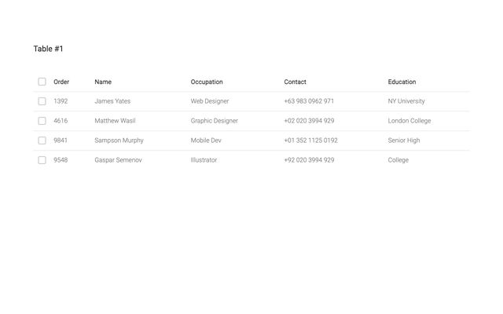</a> <b>Table 11</b> <a href="https://preview.colorlib.com/#css-table-11">Demo</a> · <a href="css-table-11/">Code</a> · <a href="https://colorlib.com/wp/template/css-table-11/">Details</a></td>
<td align="center" width="33%"><a href="https://preview.colorlib.com/#css-table-12">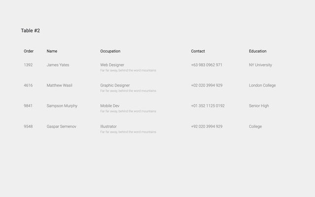</a> <b>Table 12</b> <a href="https://preview.colorlib.com/#css-table-12">Demo</a> · <a href="css-table-12/">Code</a> · <a href="https://colorlib.com/wp/template/css-table-12/">Details</a></td>
<td align="center" width="33%"><a href="https://preview.colorlib.com/#css-table-13">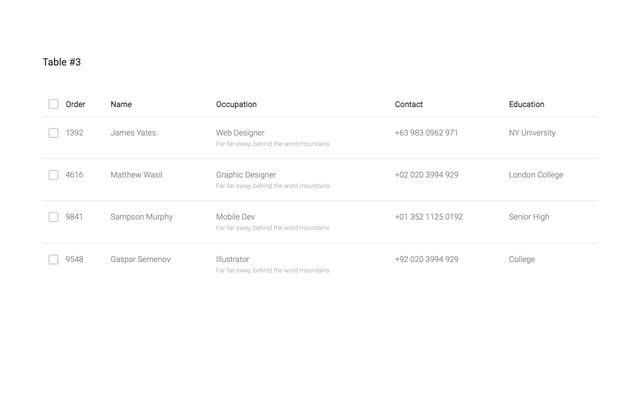</a> <b>Table 13</b> <a href="https://preview.colorlib.com/#css-table-13">Demo</a> · <a href="css-table-13/">Code</a> · <a href="https://colorlib.com/wp/template/css-table-13/">Details</a></td>
</tr>
<tr>
<td align="center" width="33%"><a href="https://preview.colorlib.com/#css-table-14">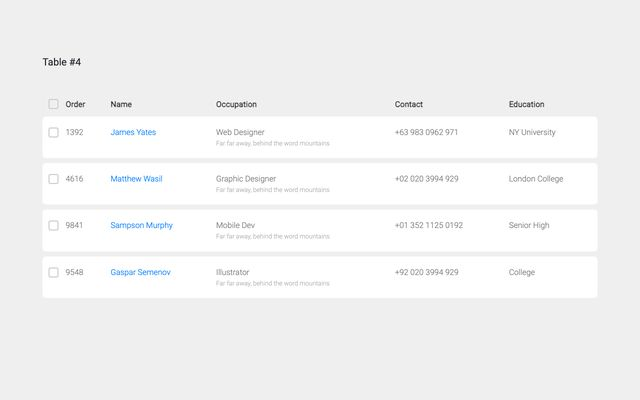</a> <b>Table 14</b> <a href="https://preview.colorlib.com/#css-table-14">Demo</a> · <a href="css-table-14/">Code</a> · <a href="https://colorlib.com/wp/template/css-table-14/">Details</a></td>
<td align="center" width="33%"><a href="https://preview.colorlib.com/#css-table-15">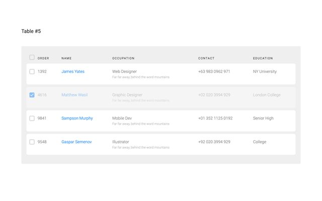</a> <b>Table 15</b> <a href="https://preview.colorlib.com/#css-table-15">Demo</a> · <a href="css-table-15/">Code</a> · <a href="https://colorlib.com/wp/template/css-table-15/">Details</a></td>
<td align="center" width="33%"><a href="https://preview.colorlib.com/#css-table-16">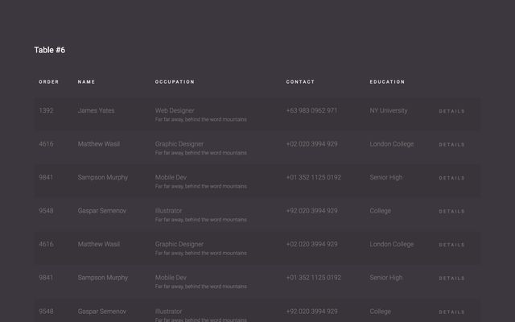</a> <b>Table 16</b> <a href="https://preview.colorlib.com/#css-table-16">Demo</a> · <a href="css-table-16/">Code</a> · <a href="https://colorlib.com/wp/template/css-table-16/">Details</a></td>
</tr>
<tr>
<td align="center" width="33%"><a href="https://preview.colorlib.com/#css-table-17">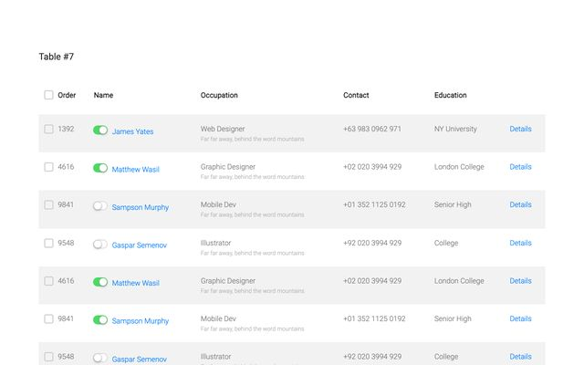</a> <b>Table 17</b> <a href="https://preview.colorlib.com/#css-table-17">Demo</a> · <a href="css-table-17/">Code</a> · <a href="https://colorlib.com/wp/template/css-table-17/">Details</a></td>
<td align="center" width="33%"><a href="https://preview.colorlib.com/#css-table-18">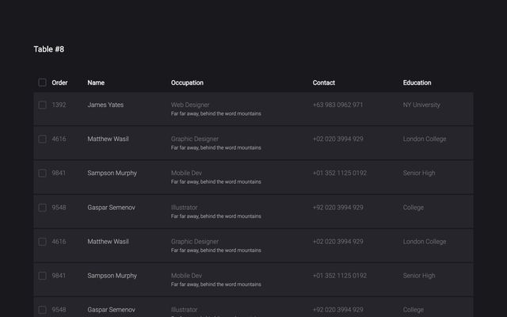</a> <b>Table 18</b> <a href="https://preview.colorlib.com/#css-table-18">Demo</a> · <a href="css-table-18/">Code</a> · <a href="https://colorlib.com/wp/template/css-table-18/">Details</a></td>
<td align="center" width="33%"><a href="https://preview.colorlib.com/#css-table-19">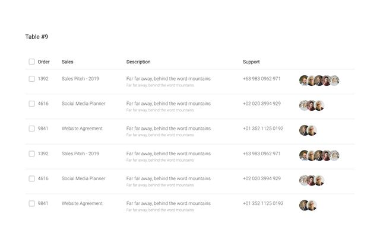</a> <b>Table 19</b> <a href="https://preview.colorlib.com/#css-table-19">Demo</a> · <a href="css-table-19/">Code</a> · <a href="https://colorlib.com/wp/template/css-table-19/">Details</a></td>
</tr>
<tr>
<td align="center" width="33%"><a href="https://preview.colorlib.com/#css-table-20">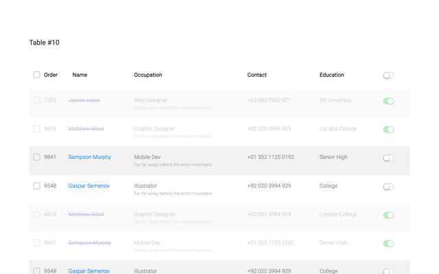</a> <b>Table 20</b> <a href="https://preview.colorlib.com/#css-table-20">Demo</a> · <a href="css-table-20/">Code</a> · <a href="https://colorlib.com/wp/template/css-table-20/">Details</a></td>
<td align="center" width="33%"><a href="https://preview.colorlib.com/#table-01">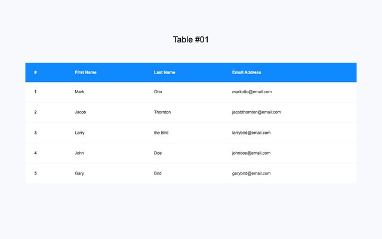</a> <b>Table 01</b> <a href="https://preview.colorlib.com/#table-01">Demo</a> · <a href="table-01/">Code</a> · <a href="https://colorlib.com/wp/template/table-01/">Details</a></td>
<td align="center" width="33%"><a href="https://preview.colorlib.com/#table-02">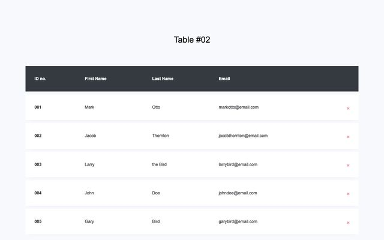</a> <b>Table 02</b> <a href="https://preview.colorlib.com/#table-02">Demo</a> · <a href="table-02/">Code</a> · <a href="https://colorlib.com/wp/template/table-02/">Details</a></td>
</tr>
<tr>
<td align="center" width="33%"><a href="https://preview.colorlib.com/#table-03">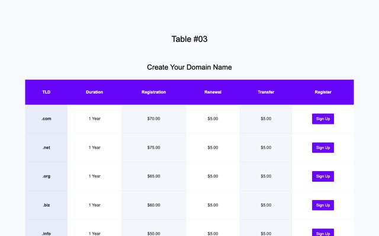</a> <b>Table 03</b> <a href="https://preview.colorlib.com/#table-03">Demo</a> · <a href="table-03/">Code</a> · <a href="https://colorlib.com/wp/template/table-03/">Details</a></td>
<td align="center" width="33%"><a href="https://preview.colorlib.com/#table-04">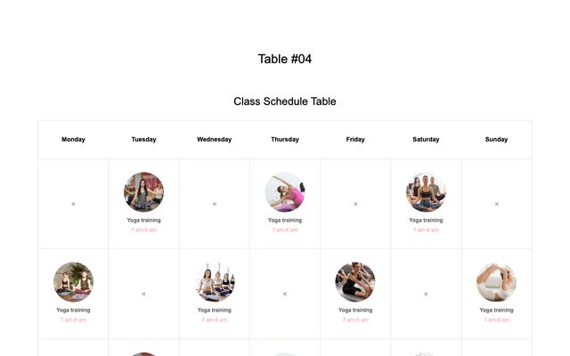</a> <b>Table 04</b> <a href="https://preview.colorlib.com/#table-04">Demo</a> · <a href="table-04/">Code</a> · <a href="https://colorlib.com/wp/template/table-04/">Details</a></td>
<td align="center" width="33%"><a href="https://preview.colorlib.com/#table-05">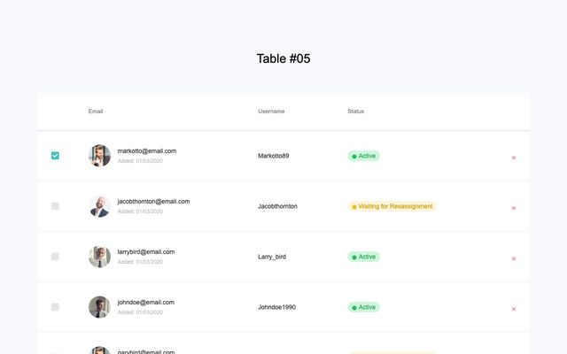</a> <b>Table 05</b> <a href="https://preview.colorlib.com/#table-05">Demo</a> · <a href="table-05/">Code</a> · <a href="https://colorlib.com/wp/template/table-05/">Details</a></td>
</tr>
<tr>
<td align="center" width="33%"><a href="https://preview.colorlib.com/#table-06">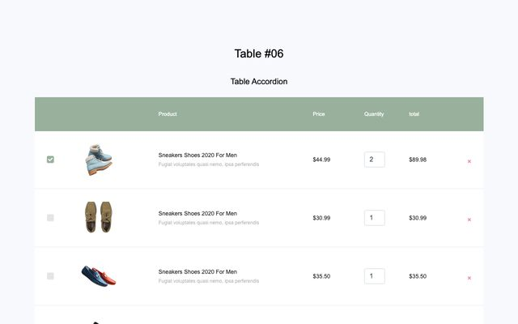</a> <b>Table 06</b> <a href="https://preview.colorlib.com/#table-06">Demo</a> · <a href="table-06/">Code</a> · <a href="https://colorlib.com/wp/template/table-06/">Details</a></td>
<td align="center" width="33%"><a href="https://preview.colorlib.com/#table-07">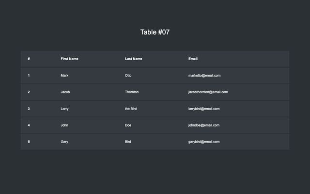</a> <b>Table 07</b> <a href="https://preview.colorlib.com/#table-07">Demo</a> · <a href="table-07/">Code</a> · <a href="https://colorlib.com/wp/template/table-07/">Details</a></td>
<td align="center" width="33%"><a href="https://preview.colorlib.com/#table-08">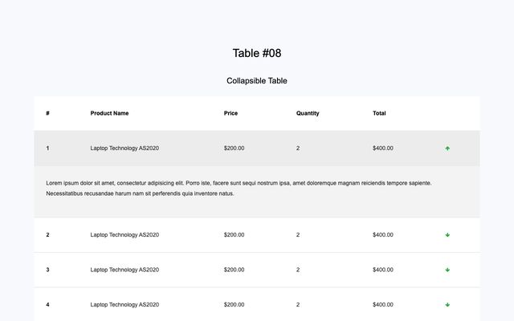</a> <b>Table 08</b> <a href="https://preview.colorlib.com/#table-08">Demo</a> · <a href="table-08/">Code</a> · <a href="https://colorlib.com/wp/template/table-08/">Details</a></td>
</tr>
<tr>
<td align="center" width="33%"><a href="https://preview.colorlib.com/#table-09">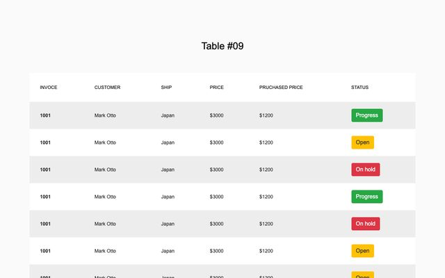</a> <b>Table 09</b> <a href="https://preview.colorlib.com/#table-09">Demo</a> · <a href="table-09/">Code</a> · <a href="https://colorlib.com/wp/template/table-09/">Details</a></td>
<td align="center" width="33%"><a href="https://preview.colorlib.com/#table-10">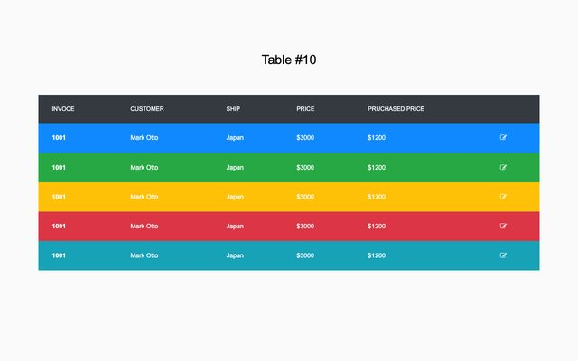</a> <b>Table 10</b> <a href="https://preview.colorlib.com/#table-10">Demo</a> · <a href="table-10/">Code</a> · <a href="https://colorlib.com/wp/template/table-10/">Details</a></td>
</tr>
</table>

## Fixed and responsive tables

<table>
<tr>
<td align="center" width="33%"><a href="https://preview.colorlib.com/#fixed-column-table">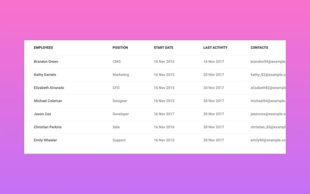</a> <b>Fixed Column Table</b> <a href="https://preview.colorlib.com/#fixed-column-table">Demo</a> · <a href="fixed-column-table/">Code</a> · <a href="https://colorlib.com/wp/template/fixed-column-table/">Details</a></td>
<td align="center" width="33%"><a href="https://preview.colorlib.com/#fixed-header-table">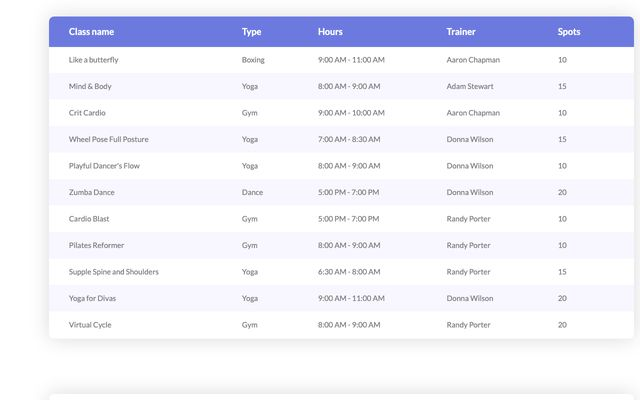</a> <b>Fixed Header Table</b> <a href="https://preview.colorlib.com/#fixed-header-table">Demo</a> · <a href="fixed-header-table/">Code</a> · <a href="https://colorlib.com/wp/template/fixed-header-table/">Details</a></td>
<td align="center" width="33%"><a href="https://preview.colorlib.com/#responsive-table-v1">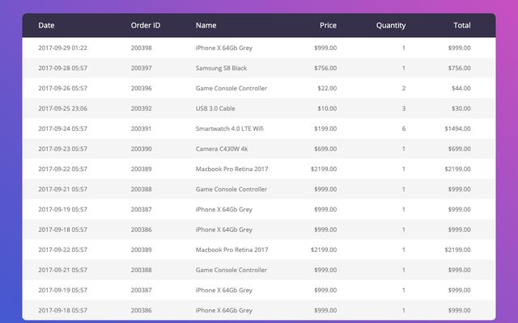</a> <b>Responsive Table V1</b> <a href="https://preview.colorlib.com/#responsive-table-v1">Demo</a> · <a href="responsive-table-v1/">Code</a> · <a href="https://colorlib.com/wp/template/responsive-table-v1/">Details</a></td>
</tr>
<tr>
<td align="center" width="33%"><a href="https://preview.colorlib.com/#responsive-table-v2">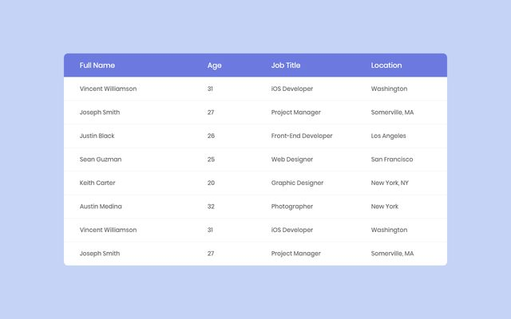</a> <b>Responsive Table V2</b> <a href="https://preview.colorlib.com/#responsive-table-v2">Demo</a> · <a href="responsive-table-v2/">Code</a> · <a href="https://colorlib.com/wp/template/responsive-table-v2/">Details</a></td>
<td align="center" width="33%"><a href="https://preview.colorlib.com/#table-with-vertical-horizontal-highlight">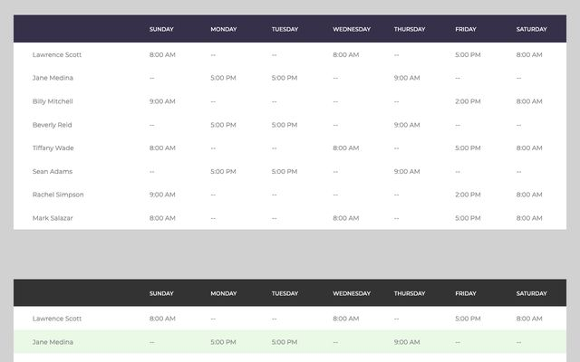</a> <b>Table With Vertical Horizontal Highlight</b> <a href="https://preview.colorlib.com/#table-with-vertical-horizontal-highlight">Demo</a> · <a href="table-with-vertical-horizontal-highlight/">Code</a> · <a href="https://colorlib.com/wp/template/table-with-vertical-horizontal-highlight/">Details</a></td>
</tr>
</table>

## How to use one

1. Clone the repo, or download it as a ZIP from the green **Code** button.
2. Copy the folder of the template you want into your project.
3. Open its `index.html` in a browser. Every folder is self-contained: `css/style.css`, a small `js/snippet.js` where the template needs behaviour, plus its own fonts and images.

Using Bootstrap already? Load the template's `css/style.css` after your framework stylesheet. Class names are namespaced per template, so they won't collide with yours.

## License

Free for personal and commercial use, including client work. Attribution is appreciated but not required. Photography, where present, is licensed for use inside these templates. See [LICENSE.md](LICENSE.md).

## More free templates from Colorlib

- [Free HTML & CSS Login Form Templates](https://github.com/ColorlibHQ/login-form-templates)
- [Free HTML & CSS Registration Form Templates](https://github.com/ColorlibHQ/registration-form-templates)
- [Free Coming Soon & Under Construction Page Templates](https://github.com/ColorlibHQ/coming-soon-page-templates)
- [Free HTML & CSS Contact Form Templates](https://github.com/ColorlibHQ/contact-form-templates)
- [Free 404 & Error Page Templates](https://github.com/ColorlibHQ/404-error-page-templates)
- [Free Multi-Step Form & Form Wizard Templates](https://github.com/ColorlibHQ/multi-step-form-templates)
- [Free Booking & Appointment Form Templates](https://github.com/ColorlibHQ/booking-form-templates)
- [Free HTML & CSS Search Form Templates](https://github.com/ColorlibHQ/search-form-templates)
- [Free Navigation Menu, Sidebar & Dropdown Templates](https://github.com/ColorlibHQ/navigation-menu-templates)
- [Free HTML Form Templates: Job Application, Survey & Newsletter](https://github.com/ColorlibHQ/html-form-templates)
- [Free HTML & CSS UI Components](https://github.com/ColorlibHQ/html-css-ui-components)

Building an admin panel or a web app?

- [Gentelella](https://github.com/ColorlibHQ/gentelella) and [Adminator](https://github.com/puikinsh/Adminator-admin-dashboard): free admin dashboard templates
- [DashboardPack](https://dashboardpack.com/templates/?utm_source=github&utm_medium=readme&utm_campaign=html-table-templates): premium dashboards for React, Vue, Angular, Next.js, Laravel and plain HTML

Made by [Colorlib](https://colorlib.com/).
